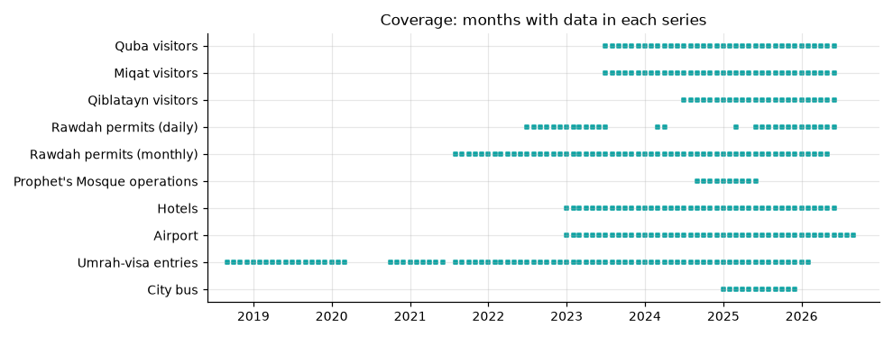
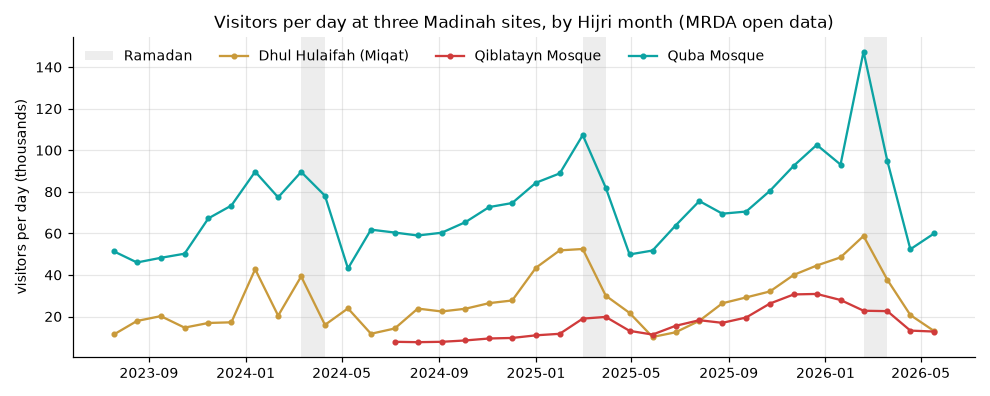
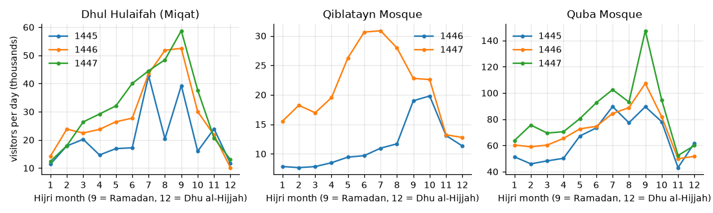
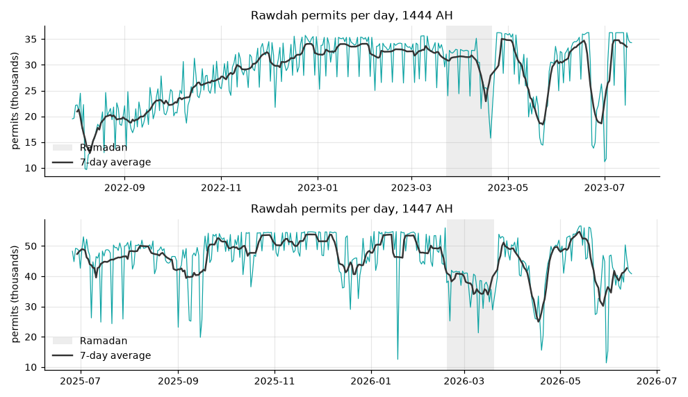
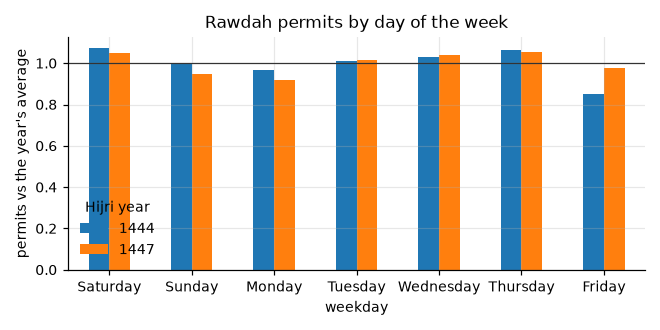
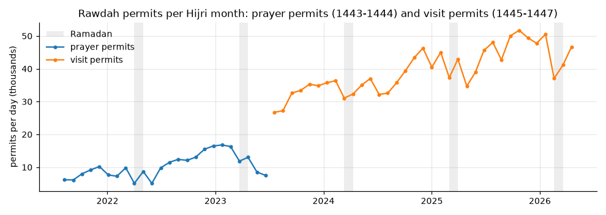
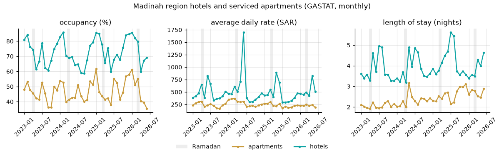
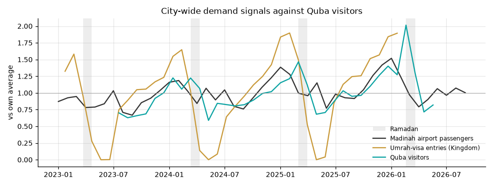
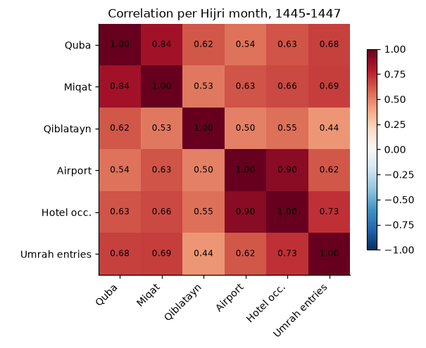
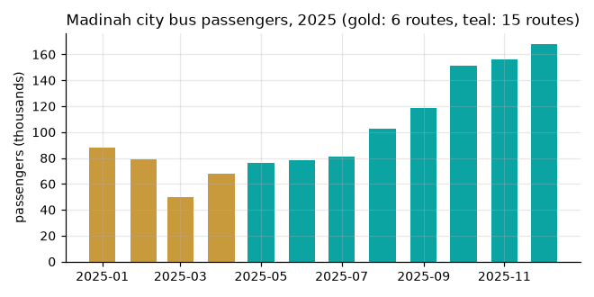

# Madinah open data: EDA

What the Saudi open data on Madinah visitors can add to this dashboard. The data is cleaned by `scripts/build_open_data.py` into `data/open/clean/`, and the charts and numbers here come from `scripts/eda_open_data.py`. Sources are listed in [`data/open/README.md`](../data/open/README.md).

## Summary

- **Real monthly visitors per site** are available for Quba, the Miqat (Dhul Hulaifah) and Qiblatayn: 2 to 3 Hijri years, monthly. They can replace the illustrative totals on those site cards now.
- **City-wide monthly series** are long enough for a monthly baseline: hotels (42 months), airport (45), Umrah-visa entries (81). Airport and hotel occupancy move together (r = 0.90).
- **Daily data exists only for the Rawdah**, and it is capped by booking capacity (66 of 352 days in 1447 at 54,000 or more), so it shows capacity used, not demand.
- **Not possible from open data:** daily or hourly visitors per site. That still needs STC or cameras.

## Coverage

| Series | Period | Frequency | Rows |
|---|---|---|---|
| Quba, Miqat visitors | Muharram 1445 – Dhu al-Hijjah 1447 (Jul 2023 – Jun 2026) | Hijri month | 36 each |
| Qiblatayn visitors | Muharram 1446 – Dhu al-Hijjah 1447 | Hijri month | 24 |
| Rawdah permits | 1443 – Dhu al-Qa'dah 1447 | Hijri month | 59 |
| Rawdah permits | 1444 and 1447 (full years), Ramadan 1445 and 1446 | day | 761 |
| Prophet's Mosque operations (doors open, carpets, wayfinding) | Rabi' I – Dhu al-Hijjah 1446 | Hijri month | 10 |
| Hotels and serviced apartments, Madinah region | Jan 2023 – Jun 2026 | month | 42 each |
| Madinah airport passengers | Jan 2023 – Sep 2026 | month | 45 |
| Umrah-visa entries (whole Kingdom) | 1440 – Sha'ban 1447 | Hijri month | 81 |
| City bus passengers | Jan – Dec 2025 | month | 12 |

## Site visitors

| Site | 1445 | 1446 | 1447 | Change 1446 → 1447 |
|---|---|---|---|---|
| Quba | 22.9M | 25.3M | 29.7M | +17% |
| Miqat | 7.4M | 10.3M | 11.3M | +10% |
| Qiblatayn | – | 4.0M | 7.6M | +89% |

- **Ramadan is the peak at Quba and the Miqat.** Quba reached 147,000 visitors a day in Ramadan 1447, up from 107,000 in Ramadan 1446.
- **Qiblatayn peaked in Jumada – Rajab in 1447 and in Ramadan – Shawwal in 1446.** Its 89% jump in 1447 is large enough to check with MRDA before we quote it.
- **Dhu al-Qa'dah is the lowest month at every site**, when Umrah entry is closed before Hajj.
- **Visitors grow through the year from Muharram to Ramadan**, then drop. A forecast has to model the Hijri calendar, not the Gregorian one.

## Rawdah permits

| Period | Days | Mean per day | Max |
|---|---|---|---|
| 1444 | 350 | 28,269 | 36,266 |
| 1447 | 352 | 46,069 | 56,642 |
| Ramadan 1445 | 30 | 31,083 | 37,916 |
| Ramadan 1446 | 29 | 37,297 | 44,926 |

- **The daily series is flat at a ceiling.** In 1447, 66 days reached 54,000 or more, and the series sits near 50,000 for months. The number shows booked slots, so it measures capacity used, not how many people wanted to visit.
- **Permits fall in Ramadan**, the opposite of the sites (about 37,000 a day in Ramadan 1447 against 46,000 for the year).
- **Friday was low in 1444 (15% below average) but not in 1447 (3% below)**, so the Friday pattern changed.

- Prayer permits (1443–1444) and visit permits (1445 on) are different permits. Do not join them into one series.
- The monthly file for Dhu al-Hijjah 1447 holds 355,558 permits, a third of the daily file's 1,117,180 for the same days. It was published early, so the build drops it.
- The other 1447 months in the monthly file match the daily file within 0.2% (1.4% in Shawwal, which has 2 days missing from the daily file).

## Hotels

- Hotel occupancy runs 59% to 86%: highest in December – February and Ramadan, lowest in August – September.
- The average daily rate spikes at Hajj and Ramadan, up to SAR 1,700 in June 2024.
- Length of stay in hotels rose in 2025, to 5.6 nights in July 2025.
- These are Madinah **region** figures, not the city or a site.

## Do the city-wide series follow the sites?

Compared per Hijri month (20 months with every series):

- Site visitors move with the city-wide series (r = 0.5 to 0.7), and Quba and the Miqat move together (0.84).
- Airport passengers and hotel occupancy move together most (0.90).
- Umrah-visa entries drop to near zero before Hajj, while airport passengers and site visitors do not, because domestic visitors keep coming.

So the city-wide series can give a monthly baseline for the city, but they cannot tell one site from another.

## City bus

Passengers almost doubled during 2025 (88,400 in January, 167,914 in December), but the network grew from 6 to 15 routes in May. The rise is mostly new service, not more demand per route. One year is too short for a trend.

## What to add to the dashboard

| Data | Where | Label |
|---|---|---|
| Monthly visitors at Quba and Qiblatayn | Site cards and the Sites view: monthly chart, year total, Ramadan peak | Real |
| Monthly visitors at the Miqat | Same, if the Miqat is added as a site (it is not in the 12 sites yet) | Real |
| Rawdah permits per day | Prophet's Mosque card, as "capacity used", not visitors | Real |
| Hotels, airport, city bus | `context.json` facts become monthly series on the Summary and Strategy views | Real |
| Monthly forecast for the city (hotels, airport) with Hijri calendar features | Strategy view, like the Fukui monthly forecast | Modelled |
| Daily or hourly visitors per site | Stays illustrative until STC or camera data | Illustrative |

## Open requests

Requests are open for longer site series, more sites (Sayyid al-Shuhada, the Seven Mosques), site capacity and daily permits for all years (open.data.gov.sa nos. 3446892, 3455366 and 3463055; Ministry of Hajj and Umrah no. 5548256). This EDA will be rerun when they arrive.
